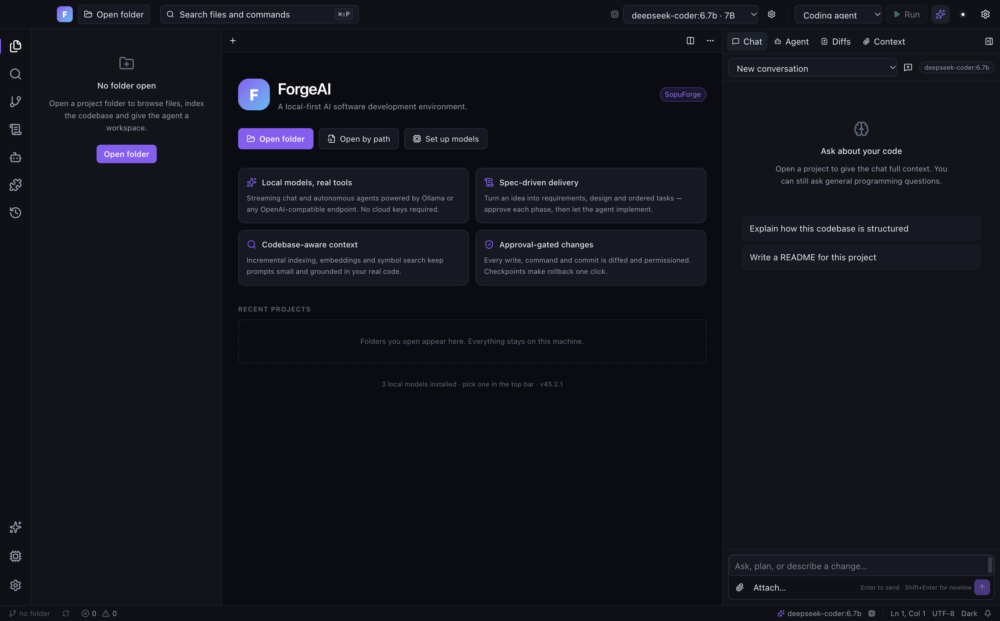

# ForgeAI (Sopu AI)

**A local-first AI software development environment.** ForgeAI is a desktop IDE built on Electron,
React, Monaco and Ollama. It runs entirely on your machine: no cloud account, no API key, and no
code leaves your computer. Cloud providers are optional.



- Streaming chat, inline completion, quick edit, explain, refactor, tests and docs
- Autonomous coding agent with a permission-gated tool registry, plus planner, debugging, testing,
  review, docs and **SEO** agents
- **Sopu AI custom models:** Optimized `sopu-coder` (7B) for agent coding and `sopu-coder-fast` (4B) for instant inline completions
- Full-stack specialization: JavaScript/TypeScript, React, Next.js, PHP (Laravel, Yii2, WordPress), and Python
- Kiro-style spec workflow: requirements → design → tasks, with explicit approvals
- Codebase indexing, embeddings (`nomic-embed-text`) and retrieval-grounded answers
- Monaco editor with tabs, split view, diffs and hunk-level accept/revert
- Built-in terminal, Git panel, search, problems, output and run/debug helpers
- **Zero-setup local AI:** ForgeAI finds, installs, starts and prepares Ollama for you
- **Apple Silicon Hardware Tuning:** Metal 4 GPU acceleration, Flash Attention, and quantized 8-bit KV cache (`q8_0`) for 50% memory savings
- **Zero-timeout streaming:** Infinite streaming duration as long as tokens are actively generating
- VS Code Dark+/Light+ colours, blue status bar and familiar tab/editor conventions

Architecture details live in [docs/ARCHITECTURE.md](docs/ARCHITECTURE.md).

---

## 1. Requirements

| Requirement | Version / notes                                                              |
| ----------- | ---------------------------------------------------------------------------- |
| Node.js     | **22 or newer** (24 LTS recommended). `node:sqlite` is required.             |
| Yarn        | **1.22.x** (classic). The repo uses Yarn 1 workspaces.                       |
| OS          | macOS 12+ (Apple Silicon or Intel) or Windows 10/11 (x64 or arm64)           |
| Disk        | ~3 GB free: dependencies, Electron, the Ollama runtime and the default model |
| RAM         | 8 GB minimum; 16 GB recommended for a 4B model plus an IDE                   |
| Network     | Needed only for the first install and for downloading the local model        |

You do **not** need to install Ollama yourself. ForgeAI manages it automatically (see
[Local AI bootstrap](#4-local-ai-bootstrap)).

Check your tools:

```bash
node -v     # must print v22.x or newer
yarn -v     # must print 1.22.x
```

If Yarn is missing:

```bash
corepack enable
corepack prepare yarn@1.22.22 --activate
```

---

## 2. Install dependencies

From the repository root:

```bash
yarn install
```

This installs all workspaces (`apps/*`, `packages/*`). No build step is needed for the workspace
packages — they are consumed from source through Vite aliases.

---

## 3. Run the app

### Development (hot reload)

```bash
yarn dev
```

This starts electron-vite with HMR for the renderer and automatic restarts for the main process.
The first window may take a few seconds while Electron starts.

### Production build, then preview locally

```bash
yarn build
yarn start
```

`yarn build` compiles the main process, preload and renderer into `apps/desktop/out/`.
`yarn start` runs that build in Electron (it does not create an installer).

### Verify the UI without opening a project

```bash
yarn smoke
```

Builds the app, launches it headlessly, waits for the renderer, captures
`apps/desktop/smoke.png` and exits with code 0. Useful in CI with a virtual display.

---

## 4. Local AI bootstrap

ForgeAI ships with a fixed local default:

| Setting    | Default                                                              |
| ---------- | -------------------------------------------------------------------- |
| Provider   | Ollama                                                               |
| Endpoint   | `http://localhost:11434`                                             |
| Model      | `qwen3.5:4b` (~3.3 GB)                                               |
| Roles      | `chat`, `coding`, `plan`, `fast`, `review` all use `qwen3.5:4b`      |
| Embeddings | optional — retrieval falls back to keyword search when not installed |
| Keep-alive | `-1` (never unload while ForgeAI is running)                         |

On launch (about 300 ms after the window opens, off the critical path) ForgeAI runs this pipeline in
the background:

1. **Check** `GET /api/version` on the configured endpoint.
2. If the server is not running, **locate** an Ollama binary:
   - `OLLAMA_BIN`, if set;
   - the managed runtime in the ForgeAI data directory;
   - common macOS/Windows install locations;
   - `which ollama` / `where ollama`.
3. If no binary exists, **download the official Ollama runtime** from GitHub Releases for the current
   OS and CPU, extract it into the ForgeAI data directory, and mark it executable. No admin prompt
   or system-wide installer is used.
4. **Start** `ollama serve` with `OLLAMA_HOST` derived from the endpoint, `OLLAMA_KEEP_ALIVE=-1`,
   `OLLAMA_NUM_PARALLEL=1`, `OLLAMA_MAX_LOADED_MODELS=1` and `OLLAMA_FLASH_ATTENTION=1`, logging to
   `logs/ollama.log`.
5. Wait for the health endpoint, then **pull** `qwen3.5:4b` if it is not already installed,
   streaming progress into the UI.
6. **Warm the model** with an empty `/api/generate` request so the first real message does not pay
   the load cost, then assign the model to every chat/coding/plan/fast/review role.
7. **Prune old models** that earlier versions pulled (for example `qwen2.5-coder:*`, `qwen3:8b`,
   `deepseek-r1:8b`). Embedding models are left alone. You can also remove everything except the
   default from **Models → Keep only qwen3.5:4b**.
8. Start a **watchdog** that checks every 15 s and restarts the managed server if it stops. An Ollama
   server you started yourself is never touched.

Progress appears in the slim banner above the editor and in **Models** (top-bar model menu →
manage models). You can cancel a download or retry from there. The app remains usable while the
runtime prepares — chat input tells you when the local model is not ready yet.

Closing the ForgeAI window quits the app on every OS and stops the `ollama serve` it started, so no
background server is left behind. A server you started yourself is left running.

### Speed, not fine-tuning

ForgeAI does **not** fine-tune or retrain `qwen3.5:4b` — there is no training data or GPU job in the
app. “Faster” comes from inference-side tuning, which is what actually helps a local IDE:

- the model stays resident (`keep_alive=-1`) so there is no reload penalty between prompts;
- a warm-up request runs at startup;
- `num_ctx` is capped at 8192, `num_batch` 512 and generation defaults to 2048 tokens;
- temperature 0.15, `top_p` 0.9, `repeat_penalty` 1.05 and thinking disabled for chat/agent calls;
- prompt budgets are smaller (rules, attachments, retrieval and history are trimmed);
- Monaco and the terminal are loaded lazily, and start-up work is deferred off the first paint.

If you want to fully customise generation, change the Ollama provider settings in **Models →
Providers**; the same values are sent on every request.

### Overrides

All are optional environment variables:

| Variable                           | Meaning                                                    |
| ---------------------------------- | ---------------------------------------------------------- |
| `FORGEAI_OLLAMA_AUTO=0`            | Disable the automatic bootstrap at launch.                 |
| `FORGEAI_OLLAMA_MODEL=llama3.2:3b` | Use a different default model. It is pulled automatically. |
| `OLLAMA_BIN=/path/to/ollama`       | Force a specific Ollama executable.                        |

Examples:

```bash
# Start manually, then connect from the app
ollama serve

# Launch ForgeAI without touching the runtime
FORGEAI_OLLAMA_AUTO=0 yarn dev

# Use your own binary and model
OLLAMA_BIN=/opt/homebrew/bin/ollama FORGEAI_OLLAMA_MODEL=qwen2.5-coder:7b yarn dev
```

The endpoint is not hard-coded into requests: change it per provider in **Models → Providers**.
ForgeAI migrates the stock `127.0.0.1:11434` address to `http://localhost:11434` and upgrades an old
`10m` keep-alive to `-1`.

### Using the agents

Open the **Agents** activity (or the AI panel → Agent) and pick a role:

| Agent     | What it is for                                                     |
| --------- | ------------------------------------------------------------------ |
| Coding    | Implements features and fixes, with hunk-level diff approval       |
| Planner   | Explores the codebase and returns an ordered plan, no edits        |
| Debugging | Reproduces failures, reads logs and applies the smallest safe fix  |
| Testing   | Writes and runs tests, fills coverage gaps                         |
| Review    | Read-only audit for correctness, security and performance          |
| Docs      | README sections, API references and code documentation             |
| SEO       | Crawlability, metadata, structured data, Core Web Vitals and links |

Each role has example task chips — click one to fill the prompt, then press **Start** (or `⌘⇧↵` to
start the coding agent from anywhere). The SEO agent begins with a read-only `seo_audit` tool that
scans up to 24 pages plus six config files for titles, descriptions, canonicals, Open Graph,
Twitter cards, JSON-LD, viewport, `robots.txt` and sitemap coverage, then proposes framework-native
fixes. Commands, installs, commits and writes always pause for explicit permission, and a checkpoint
is created before the first write.

### Offline / manual setup

If automatic download is blocked by a proxy or firewall:

```bash
# 1. Install Ollama yourself, or place the archive/binary where ForgeAI can see it.
# 2. Start the server.
ollama serve

# 3. Pull the base weights once (or let ForgeAI auto-pull and build on first launch):
ollama pull qwen2.5-coder:7b
ollama pull qwen3.5:4b

# 4. Build the custom Sopu AI models (ForgeAI also auto-builds these on startup if missing):
ollama create sopu-coder -f modelfiles/Modelfile.sopu-coder
ollama create sopu-coder-fast -f modelfiles/Modelfile.sopu-coder-fast

# 5. Launch ForgeAI; it detects the models and assigns roles automatically.
yarn dev
```

Ollama's own documentation: <https://ollama.com/download>.

### Where data lives

The app forces its user-data directory to `<appData>/ForgeAI`:

| Platform | Path                                     |
| -------- | ---------------------------------------- |
| macOS    | `~/Library/Application Support/ForgeAI/` |
| Windows  | `%APPDATA%\ForgeAI\`                     |

Contents include:

- `forgeai.db` — SQLite database (projects, chats, settings, index metadata)
- `logs/ollama.log` — stdout/stderr from the managed Ollama server
- `runtime/ollama/` — managed Ollama binary (when ForgeAI installed it)

Conversations, checkpoints and indexed chunks stay in this directory. Delete the folder to reset all
ForgeAI state; models are kept in Ollama's own store (`~/.ollama`).

---

## 5. Local Model Optimization & Apple Silicon Tuning

ForgeAI is tuned specifically for Apple Silicon (M1/M2/M3/M4) unified memory architectures, ensuring high inference speeds, zero OOM crashes, and deep context stability on 16 GB machines.

### Real Benchmark (MacBook Pro M1 Pro 16 GB RAM)

| Model Profile | Base Weight | Parameters | VRAM Footprint | Prompt Speed | Generation Speed | Context Headroom |
| :--- | :--- | :---: | :---: | :---: | :---: | :---: |
| **`sopu-coder`** *(Primary)* | `qwen2.5-coder:7b` | 7.6B | **4.8 GB** | **148.1 tok/s** | **13.4 tok/s** | **8,192 tokens** |
| **`sopu-coder-fast`** *(Inline)* | `qwen3.5:4b` | 4.2B | **3.1 GB** | **186.3 tok/s** | **18.5 – 21.4 tok/s** | **4,096 tokens** |
| `nomic-embed-text` *(RAG)* | `nomic-embed-text` | 137M | **274 MB** | N/A | High throughput | **2,048 tokens** |
| `qwen2.5-coder:14b` *(Heavy)* | `qwen2.5-coder:14b` | 14.8B | **9.5 GB** | 38.5 tok/s | 5.4 tok/s | Memory tight (~6% free) |

> [!TIP]
> **Why 7B is the sweet spot for 16 GB Macs:** `sopu-coder` (7B) is **2.5x faster** than 14B (13.4 tok/s vs 5.4 tok/s) and uses only 4.8 GB VRAM. This leaves **~11 GB of unified memory completely free** for WebStorm, VS Code, Node dev servers, Docker, and Chrome without swap thrashing.

### Apple Silicon Inference Engine Flags

To achieve maximum performance, configure Ollama with these environment flags (ForgeAI sets these automatically in managed mode):

```bash
# Faster prefill and decode via Metal shader acceleration
export OLLAMA_FLASH_ATTENTION=1

# 8-bit quantized KV cache cuts attention memory overhead by 50%
export OLLAMA_KV_CACHE_TYPE=q8_0

# Strict single-model residency prevents VRAM thrashing on 16GB
export OLLAMA_MAX_LOADED_MODELS=1
export OLLAMA_NUM_PARALLEL=1

# Initial context length
export OLLAMA_CONTEXT_LENGTH=8192
```

To make these permanent on macOS across reboots and GUI launches:

```bash
launchctl setenv OLLAMA_FLASH_ATTENTION 1
launchctl setenv OLLAMA_KV_CACHE_TYPE q8_0
launchctl setenv OLLAMA_NUM_PARALLEL 1
launchctl setenv OLLAMA_MAX_LOADED_MODELS 1
launchctl setenv OLLAMA_CONTEXT_LENGTH 8192
```

### Zero-Timeout Streaming Architecture

Local models processing large multi-file diffs or extensive test plans can take several minutes to output. ForgeAI implements an **activity-based streaming controller**:
- **10-minute initial window:** Gives heavy models ample time for cold-loading from SSD and large prompt prefill without timing out.
- **Inactivity refresh (180s):** The timeout timer automatically resets every time a token or chunk arrives. As long as the model is actively streaming code, requests **never time out**.

### Monaco & Eclipse Theia Performance Architecture

ForgeAI adopts performance patterns directly from the **[Microsoft Monaco Editor](https://github.com/microsoft/monaco-editor)** and **[Eclipse Theia](https://github.com/eclipse-theia/theia)** IDE platforms to guarantee responsive 60+ FPS editing even in large monorepos:

1. **Large File & Long Line Protection (`maxTokenizationLineLength: 20000`, `stopRenderingLineAfter: 10000`):**
   - Minified JavaScript, bundle maps, and large JSON dumps cannot freeze Monaco's syntax highlighting or lock the UI thread.
2. **Optimized Whitespace & Folding Overhead:**
   - Whitespace rendering is constrained to `selection`, drastically reducing DOM element allocation compared to full-document whitespace glyphs.
   - Code folding uses the fast, zero-AST `indentation` strategy.
3. **Hardware-Accelerated Smooth Scrolling:**
   - Smooth caret animations (`cursorSmoothCaretAnimation: 'on'`) combined with `fastScrollSensitivity: 6` and `cursorSurroundingLines: 3` ensure fluid, edge-cushioned scrolling.
4. **Memory Leak Prevention via Theia Model Disposal Lifecycle:**
   - In standard Monaco setups, every opened file allocates an in-memory `ITextModel` that persists indefinitely.
   - ForgeAI mirrors Eclipse Theia's model lifecycle: when a tab is closed, the associated model URI is checked against active editor tabs. If closed, `monaco.editor.getModel(uri)?.dispose()` immediately reclaims heap memory, preventing memory bloat across multi-hour coding sessions.
5. **Keystroke Cancellation Debouncing:**
   - Inline completions are debounced by 200 ms with active `token.onCancellationRequested` listeners. Rapid typing aborts prior requests before IPC dispatch, keeping Ollama's inference queue free of stale work.

---

## 6. How to Use ForgeAI Properly

### 1. Model Selection & Roles
- **Active Model Dropdown:** Click the model dropdown in the top-right header of the **AI Assistant** panel (or press `⌘⌥B` to toggle AI).
- **Local Zero-Cost Inference:** Select `sopu-coder (Local)` (7B) for deep multi-file agentic tasks or `sopu-coder-fast (Local)` (4B) for high-speed autocomplete.
- **Optional Cloud Models:** If you need Claude 3.5 Sonnet, DeepSeek V3/R1, or Groq, navigate to **Manage Models** (`⌘K ⌘S` → Models or click `Manage`), enter your API key, and enable the provider. The active model dropdown updates instantly.

### 2. Autonomous Agent Mode (`⌘⇧↵`)
- Switch the chat panel to **Agent** mode (or select **Coding**, **Planner**, **Debugging**, **Testing**, **Review**, **Docs**, or **SEO**).
- Give the agent a high-level goal (e.g. `Implement authentication middleware and update routing in src/`).
- **Unified Action Cards:**
  - Instead of raw JSON dumps (`{"name": "read_file", ...}`), the agent renders clean, interactive **Action Cards**:
    - 📄 **Read File**: Shows path, size, and offers 1-click **Open in Editor**.
    - ✏️ **Edit / Create File**: Displays affected files with live additions/deletions (`+N -M`) diff badges.
    - 💻 **Terminal Command**: Renders styled bash command pills with exit status and a 1-click **Copy Output** button.
    - 🧭 **Workspace Scan**: Compact hierarchical folder overview.

### 3. Live Terminal & Workspace Code Panel Synchronization
- **Instant Code & Tree Sync:** When you execute commands in the built-in terminal (`touch`, `mkdir`, `rm`, `npm run build`, `composer install`), changes are instantly detected and rendered in the left-side **File Explorer** and active **Monaco Editor** tabs without requiring manual refresh.
- **Expanded Directory Memory:** Unlike basic file trees that collapse or freeze, ForgeAI automatically queries all currently expanded directories whenever the workspace changes, ensuring nested additions and modifications appear immediately.
- **Terminal Git Operations:** Git commands executed in the terminal (`git checkout`, `git switch`, `git add`, `git commit`, `git pull`, `git reset`) update `.git/HEAD` and `.git/index`, which instantly broadcasts a `git:changed` event to refresh the **Source Control** sidebar and gutter indicators.
    - ✏️ **Edit File**: Shows exact file paths with live `+additions -deletions`.
    - 💻 **Terminal Command**: Shows commands with exit codes, execution output, and quick **Copy Output**.
    - 🧭 **Workspace Scan**: Shows indexed files and stack overview.
  - Intermediate tool call steps can be expanded/collapsed individually.
  - Review all file changes in the **Diffs** tab or the collapsible **File changes** drawer before approving writes.

### 3. Inline AI Editing (`⌘K`)
- In any code file, select a block of code (or leave cursor at target location) and press `⌘K`.
- Type an instruction (e.g., `Add error boundary and typed props`).
- Inspect the inline preview diff and press **Accept** (`Enter`) or **Discard** (`Esc`).

### 4. Codebase Context Pinning (`📎 Attach`)
- Click **📎 Attach** (or use the context file pills) to pin reference files directly into the prompt context for chat or agent runs.
- ForgeAI will ground its reasoning in those files using local vector embeddings (`nomic-embed-text`) and keyword search.

---

## 7. Sharing & Reproducing Models with Git

Raw GGUF model files are between 3 GB and 9 GB in size. Tracking multi-gigabyte binary blobs directly in Git is discouraged because:
1. GitHub enforces a strict 100 MB file limit.
2. Git LFS imposes bandwidth and storage costs.
3. Binary blobs make diffing and version control impossible.

### The Git Recipe Pattern: `modelfiles/`

ForgeAI uses **Git-tracked Modelfile recipes**. The repository tracks the exact instructions, temperature, top-p, repeat penalty, context window, and tailored system prompt, while pulling the base quantized weights on demand.

The repository includes two tracked recipes in [`modelfiles/`](modelfiles/):
- [`modelfiles/Modelfile.sopu-coder`](modelfiles/Modelfile.sopu-coder): 7B full-stack engineering model (TypeScript, React, Next.js, PHP, Python, tool-calling).
- [`modelfiles/Modelfile.sopu-coder-fast`](modelfiles/Modelfile.sopu-coder-fast): 4B low-latency inline completion model.

### Zero-Step Automated Installation (In-App)

ForgeAI now **automatically builds and installs `sopu-coder` and `sopu-coder-fast` directly inside the app**:
1. **On First Launch / Runtime Bootstrap:**
   - ForgeAI checks if `sopu-coder` and `sopu-coder-fast` are present.
   - If missing, it downloads the base weights (`qwen2.5-coder:7b` and `qwen3.5:4b`) and immediately compiles the custom models via the `/api/create` engine.
2. **On Model Pull in UI:**
   - Whenever you pull `qwen2.5-coder:7b` (or click pull `sopu-coder`), ForgeAI pulls the layers and immediately compiles `sopu-coder`.
   - Whenever you pull `qwen3.5:4b` (or click pull `sopu-coder-fast`), ForgeAI pulls the layers and immediately compiles `sopu-coder-fast`.
   - The role bindings (`chat`, `coding`, `plan`, `review`, and `fast`) are automatically configured to use these customized Sopu models.

### 1-Click Setup for Team Members via CLI

When a teammate or collaborator clones the repository, they can build all optimized models with a single script:

```bash
git clone https://github.com/sopu175/ForgeAI---A-local-first-AI-software-development-environment..git
cd ForgeAI---A-local-first-AI-software-development-environment.

# Run the automated model builder
chmod +x scripts/setup-models.sh
./scripts/setup-models.sh
```

### Manual Recipe Reproduction

To manually reproduce or customize the models:

```bash
# 1. Pull the base weights
ollama pull qwen2.5-coder:7b
ollama pull qwen3.5:4b
ollama pull nomic-embed-text

# 2. Build the customized Sopu AI models from the Modelfiles
ollama create sopu-coder -f modelfiles/Modelfile.sopu-coder
ollama create sopu-coder-fast -f modelfiles/Modelfile.sopu-coder-fast

# 3. Verify
ollama list
```

### Sharing Models via Ollama Registry or Hugging Face

If you want to distribute ready-to-run models without rebuilding from source:

1. **Push to the Ollama Registry:**
   ```bash
   ollama cp sopu-coder your-username/sopu-coder
   ollama push your-username/sopu-coder
   ```
   Teammates can then simply run:
   ```bash
   ollama run your-username/sopu-coder
   ```

2. **Push to Hugging Face:**
   Export the GGUF using `ollama show --modelfile sopu-coder` and push to Hugging Face Hub using `huggingface-cli upload`.

---

## 8. Continuous Custom Model Training & Fine-Tuning Pipeline

A common requirement for teams and developers is: **"How can my custom model continuously train and learn from real interactions across everyone using the application, and how do we distribute the newly trained models?"**

### The Core Architecture

In local desktop IDEs, models **cannot** perform continuous gradient backpropagation in-memory during real-time typing without exhausting GPU VRAM, crashing system memory, or causing multi-second editor freezes.

Instead, Sopu AI provides an **Autonomous Data Harvesting & Continuous LoRA Fine-Tuning Pipeline**:

```
┌───────────────────────────────────────────────┐
│           User & Agent Coding Activity        │
│       (Chat, Agent Edits, Diffs, Fixes)       │
└───────────────────────┬───────────────────────┘
                        │ 1. Auto-Log to SQLite
                        ▼
┌───────────────────────────────────────────────┐
│          forgeai.db (Local Storage)           │
│       Private, zero cloud telemetry           │
└───────────────────────┬───────────────────────┘
                        │ 2. yarn export-data
                        ▼
┌───────────────────────────────────────────────┐
│        training/train.jsonl Dataset           │
│       Formatted instruction-tuning pairs      │
└───────────────────────┬───────────────────────┘
                        │ 3. yarn train:lora (4-bit QLoRA)
                        ▼
┌───────────────────────────────────────────────┐
│         sopu-coder-lora.gguf Adapter          │
│         Compact weights (20 MB – 80 MB)       │
└───────────────────────┬───────────────────────┘
                        │ 4. Modelfile / Ollama Push
                        ▼
┌───────────────────────────────────────────────┐
│   All Users Automatically Get Retrained Model │
│    • 1-Click pull via Ollama Hub              │
│    • Or distributed via Git-tracked recipes   │
└───────────────────────────────────────────────┘
```

### Step 1: Automatic Interaction Harvesting
Every successful turn in ForgeAI is saved to the local SQLite database (`forgeai.db`):
- User prompts and attached code context
- Assistant responses, reasoning traces, and tool calls
- Accepted git diffs and code corrections
- Prompt and completion token counts and duration metrics

This data is **100% private to your machine** by default—no telemetry leaves your computer.

### Step 2: One-Command Dataset Export (`yarn export-data`)
To harvest high-quality training pairs from your real-world usage, run:

```bash
yarn export-data
```

This runs [`scripts/export-training-data.mjs`](scripts/export-training-data.mjs), which:
1. Connects to `forgeai.db`.
2. Filters out aborted runs, errors, empty prompts, and raw tool syntax.
3. Formats conversations into standard Hugging Face / OpenAI / ShareGPT instruction format:
   ```json
   {"messages": [{"role": "user", "content": "..."}, {"role": "assistant", "content": "..."}]}
   ```
4. Automatically splits the dataset into `training/train.jsonl` (90%) and `training/eval.jsonl` (10%).

### Step 3: 4-bit LoRA Parameter-Efficient Fine-Tuning (`yarn train:lora`)
Instead of retraining billions of base weights (which requires high-end data centers), Sopu AI fine-tunes a **Low-Rank Adaptation (LoRA)** adapter ($\Delta W$). This trains only ~0.5% of parameters while preserving the base model's general reasoning capabilities.

You can run fine-tuning on consumer hardware (MacBook Pro M1/M2/M3/M4 with 16 GB RAM or a PC with an NVIDIA GPU):

```bash
# Install fine-tuning dependencies (one-time)
pip install torch transformers peft trl bitsandbytes datasets accelerate

# Run LoRA fine-tuning
yarn train:lora
```

> [!TIP]
> **For Apple Silicon Mac users:** You can also use Apple's native **MLX** framework for lightning-fast training directly on the unified memory GPU:
> ```bash
> pip install mlx-lm
> mlx_lm.lora --model Qwen/Qwen2.5-Coder-7B-Instruct --data ./training/ --train --iters 600 --batch-size 2 --lora-layers 16
> ```

### Step 4: Link the Trained Adapter in `modelfiles/`
Once the LoRA adapter is exported to GGUF (`training/output/sopu-coder-lora.gguf`):
1. In [`modelfiles/Modelfile.sopu-coder`](modelfiles/Modelfile.sopu-coder), reference the new adapter:
   ```dockerfile
   FROM qwen2.5-coder:7b
   ADAPTER ./sopu-coder-lora.gguf
   PARAMETER temperature 0.2
   PARAMETER top_p 0.95
   PARAMETER stop "<|im_end|>"
   ```
2. Compile the updated model locally:
   ```bash
   ollama create sopu-coder -f modelfiles/Modelfile.sopu-coder
   ```

### Step 5: Distribute to Everyone Using the Application

To ensure that **everyone who uses the application gets the newly trained model**:

#### Method A: Ollama Hub (Recommended - Instant 1-Command Sync)
Push your trained model to the official Ollama registry under your namespace:
```bash
# Tag and push your trained model
ollama cp sopu-coder your-team/sopu-coder
ollama push your-team/sopu-coder
```
When new users download ForgeAI or existing users open the app, setting:
```bash
FORGEAI_OLLAMA_MODEL=your-team/sopu-coder
```
or selecting it in **Models → Add Model** will download and run your trained model with zero compilation required!

#### Method B: GitHub Releases (Lightweight GGUF Adapter)
Because LoRA adapters are small (typically only **20 MB – 80 MB** compared to 5 GB base weights):
1. Upload `sopu-coder-lora.gguf` as an asset to a GitHub Release.
2. Update `scripts/setup-models.sh` to download the adapter during setup.
3. Every teammate running `./scripts/setup-models.sh` automatically compiles the customized, trained model.

#### Method C: Team Continuous Federated Training
For teams or organizations:
1. Team members periodically run `yarn export-data`.
2. Anonymized `.jsonl` files are pushed to an internal repository or S3/GCS bucket.
3. A scheduled CI workflow (or GPU runner) fine-tunes the weekly checkpoint, updates `Modelfile.sopu-coder`, and pushes the new revision to the internal Ollama server or Ollama Hub.

---

## 9. Windows & Cross-Platform Compatibility

ForgeAI is fully cross-platform with first-class support for both macOS (Apple Silicon & Intel) and Windows 10/11 (x64 and arm64).

### Key Windows Engineering Fixes
1. **Loopback IPv4 Normalization (Fixes Windows `fetch failed`):**
   - On Windows, Node.js / Undici resolves `localhost` to IPv6 `::1` by default. Because Ollama for Windows listens exclusively on IPv4 `127.0.0.1:11434`, standard fetch calls would fail with `ECONNREFUSED` / `fetch failed`.
   - ForgeAI automatically normalizes `localhost` to `127.0.0.1` on `win32` and implements an automatic dual-stack fallback in `packages/ai/src/http.ts`, guaranteeing instant connectivity.
2. **Case-Insensitive Windows Path Comparisons:**
   - Windows file systems are case-insensitive and `fs.realpath` returns canonical uppercase drive letters (e.g. `C:\...`) while workspaces may open with lowercase (e.g. `c:\...`).
   - ForgeAI incorporates `isWithinRoot` path normalization in `workspace.ts`, eliminating `Symlink escapes workspace` errors during agent file modifications on Windows.
3. **Native NSIS Installer & Portable Executable:**
   - Full support for Windows NSIS auto-upgrading installers (`ForgeAI-0.1.0-x64.exe`) and zero-install portable builds (`ForgeAI-0.1.0-x64-portable.exe`).

---

## 10. Build installers

Installer builds use [electron-builder](https://www.electron.build/). Configuration lives in
[`apps/desktop/electron-builder.yml`](apps/desktop/electron-builder.yml).

Every `dist:*` command runs [`scripts/clean.mjs`](scripts/clean.mjs) first. It deletes
`apps/desktop/out/`, `apps/desktop/dist/` and the Vite cache, so a build can never contain files
from a previous version. Use it on its own any time:

```bash
yarn clean
```

### macOS (build on macOS)

```bash
yarn dist:mac
```

Output in `apps/desktop/dist/`:

- `ForgeAI-<version>-arm64.dmg` and `ForgeAI-<version>-x64.dmg`
- `ForgeAI-<version>-arm64.zip` and `ForgeAI-<version>-x64.zip` (useful for auto-update tooling)

After packaging, ForgeAI removes the unpacked `dist/mac*/ForgeAI.app` copies. macOS indexes any
`.app` under your home folder, so leaving them would put duplicate ForgeAI icons in Launchpad next
to the installed app.

For a quick **unsigned** local build:

```bash
CSC_IDENTITY_AUTO_DISCOVERY=false yarn dist:mac
```

Unsigned apps show a Gatekeeper warning on other machines. To distribute publicly, sign with a
Developer ID certificate and notarize; set `CSC_LINK` / `CSC_KEY_PASSWORD` or use a keychain identity,
then add notarization credentials. Never commit certificates or passwords.

**Installing an update:** quit ForgeAI, open the new DMG and drag **ForgeAI** onto **Applications**,
replacing the existing copy. The app identifier (`dev.forgeai.desktop`) stays the same, so macOS
treats it as the same app and your settings, chats and index remain in
`~/Library/Application Support/ForgeAI/`. If macOS keeps an old copy under a different name, drag
that stale copy to the Trash once.

### Windows (build on Windows)

```bash
yarn dist:win
```

Output in `apps/desktop\dist\`:

- `ForgeAI-<version>-x64.exe` and `ForgeAI-<version>-arm64.exe` NSIS installers
- `ForgeAI-<version>-x64-portable.exe`

Building Windows targets from macOS/Linux requires Wine and is not the supported path; run the
command on a Windows machine (or a Windows CI runner) for reliable artifacts.

**Installing an update:** run the new installer. The NSIS package uses the same `appId` and
`uninstallDisplayName`, so it upgrades the existing installation in place and replaces the old
files; you do not need to uninstall first. `deleteAppDataOnUninstall: false` means
`%APPDATA%\ForgeAI` (settings, chats, index) is preserved across upgrades and even after an
uninstall.

### Sharing the built files

After building, hand the artefacts to users directly:

- macOS: share the `.dmg` (Apple Silicon users need `-arm64`, Intel users need `-x64`).
- Windows: share the `.exe` installer; the `-portable.exe` needs no installation.

Unsigned builds are fine for personal or internal use. For public distribution, sign and notarize
on macOS, and code-sign the Windows installer so SmartScreen trusts it. Never ship your `.env` file,
certificates or signing passwords with a build.

### Build only the JavaScript bundle

```bash
yarn build          # out/main, out/preload, out/renderer
```

The renderer is static; the main and preload bundles stay CommonJS/ESM as emitted by electron-vite.
Workspace packages are bundled into the main process, and `node-pty` is unpacked from the asar
archive so its N-API prebuild loads at runtime.

---

## 11. Complete Keyboard Shortcuts & Keybindings

ForgeAI supports standard VS Code / JetBrains / Sublime style keybindings across macOS and Windows:

| Action | macOS | Windows / Linux |
| :--- | :--- | :--- |
| **Command Palette** | `⌘⇧P` | `Ctrl+Shift+P` |
| **Quick Open File** | `⌘P` / `⌘O` | `Ctrl+P` / `Ctrl+O` |
| **Inline AI Edit (Diff Preview)** | `⌘K` | `Ctrl+K` |
| **Start Coding Agent** | `⌘⇧↵` | `Ctrl+Shift+Enter` |
| **Toggle AI Assistant Panel** | `⌘⌥B` | `Ctrl+Alt+B` |
| **Toggle File Explorer** | `⌘⇧E` | `Ctrl+Shift+E` |
| **Global Text Search** | `⌘⇧F` | `Ctrl+Shift+F` |
| **Toggle Source Control (Git)** | `⌘⇧G` | `Ctrl+Shift+G` |
| **Toggle Built-in Terminal** | `⌃\`` / `⌘J` | `Ctrl+\`` / `Ctrl+J` |
| **Toggle Problems Panel** | `⌘⇧M` | `Ctrl+Shift+M` |
| **Save Active File** | `⌘S` | `Ctrl+S` |
| **Close Tab** | `⌘W` | `Ctrl+W` |
| **New File** | `⌘N` | `Ctrl+N` |
| **Find in Active Editor** | `⌘F` | `Ctrl+F` |
| **Find & Replace in Editor** | `⌘⌥F` | `Ctrl+H` |
| **Go to Line Number** | `⌃G` | `Ctrl+G` |
| **Toggle Line Comment** | `⌘/` | `Ctrl+/` |
| **Toggle Block Comment** | `⌥⇧A` | `Shift+Alt+A` |
| **Format Document** | `⌥⇧F` | `Shift+Alt+F` |
| **Open Settings & Keybindings** | `⌘,` / `⌘K ⌘S` | `Ctrl+,` / `Ctrl+K Ctrl+S` |

---

## 12. Quality checks & Verification

```bash
yarn typecheck      # strict TypeScript for main, preload, renderer and shared packages
yarn test           # Vitest suite (33 tests covering diff engine, tokens, and formatters)
yarn test:watch     # Vitest in interactive watch mode
yarn lint           # ESLint across all workspaces
yarn format:check   # Prettier verification
yarn format         # Prettier write / auto-format
yarn smoke          # Headless UI launch test + automated screenshot capture
```

Run `yarn typecheck && yarn test && yarn build` before submitting pull requests or cutting a release.

---

## 13. Project layout

```
sopu-agent-ai/
├── apps/
│   └── desktop/
│       ├── src/main/            Electron main process
│       │   ├── index.ts         Lifecycle, window management, auto-start
│       │   ├── ipc.ts           Typed, validated IPC router
│       │   ├── services/        Workspace, db, search, index, git, terminal, providers, Ollama runtime
│       │   ├── agent/           Agent execution loop, tools, prompt orchestration
│       │   └── specs/           Requirements/design/tasks spec pipeline
│       ├── src/preload/         contextBridge security boundary
│       ├── src/renderer/        React UI (Monaco editor, AI panels, diffs, dialogs)
│       ├── build/               App icons and packaging resources
│       ├── electron-builder.yml Cross-platform packaging targets (DMG, ZIP, NSIS EXE)
│       └── scripts/smoke.mjs    Headless smoke test
├── packages/
│   ├── shared/                  Shared types, IPC contract, Zod schemas, default configs
│   ├── ai/                      Provider clients, streaming controllers, tool call parsers, loopback normalizer
│   └── core/                    Indexing, retrieval, vector search, specs, rules, unified diffs
├── modelfiles/                  Git-tracked Modelfile recipes (sopu-coder, sopu-coder-fast)
├── training/                    Exported instruction datasets for continuous model fine-tuning
├── docs/                        Architecture specifications and benchmark reports
├── scripts/
│   ├── clean.mjs                Removes build artifacts before fresh packaging
│   ├── setup-models.sh          Automated model pull & build script for teams
│   ├── export-training-data.mjs One-command dataset exporter from forgeai.db
│   └── train-lora.py            4-bit LoRA continuous fine-tuning script
├── tests/                       Vitest suites for shared helpers and the diff engine
├── package.json                 Yarn workspaces and root scripts
└── vitest.config.mts, eslint.config.mjs, .prettierrc.json, apps/desktop/electron.vite.config.ts
```

### Useful CLI Scripts

| Command                     | What it does                                                 |
| --------------------------- | ------------------------------------------------------------ |
| `yarn export-data`          | Extracts clean training pairs from `forgeai.db` into `training/train.jsonl` |
| `yarn train:lora`           | Runs 4-bit LoRA fine-tuning on harvested coding interactions |
| `./scripts/setup-models.sh` | Pulls base weights and creates custom Sopu AI models         |
| `yarn dev`                  | Run from source with hot module reloading                    |
| `yarn build`                | Build main, preload and renderer for production              |
| `yarn clean`                | Delete `out/`, `dist/` and Vite caches                       |
| `yarn start`                | Preview the production build in Electron                     |
| `yarn typecheck`            | Strict TypeScript type checking across all workspaces        |
| `yarn test`                 | Run Vitest test suite                                        |
| `yarn smoke`                | Headless UI smoke test                                       |
| `yarn dist:mac`             | Clean build + macOS DMG and ZIP (arm64, x64)                 |
| `yarn dist:win`             | Clean build + Windows NSIS installer and portable exe        |

---

## 14. Troubleshooting & FAQ

**Windows: Agent chat shows `fetch failed` / `ECONNREFUSED ::1:11434`.**
This occurs when Node.js attempts to resolve `localhost` via IPv6 `::1`, while Ollama for Windows listens exclusively on IPv4 `127.0.0.1`. ForgeAI handles this automatically via `safeFetch` and loopback normalization. If using an external server, ensure your provider endpoint in **Models → Providers** is set to `http://127.0.0.1:11434`.

**Port 11434 is already in use.** Another Ollama instance or background daemon is bound to it. ForgeAI will safely connect to a healthy Ollama instance at that address; otherwise stop the other process or change the port in **Models → Providers**.

**The runtime downloaded but the server will not start.** Read `<data>/logs/ollama.log`. Common causes are a quarantined binary on macOS (`xattr -dr com.apple.quarantine <data>/runtime/ollama`) or an antivirus blocking executable paths on Windows.

**Model download stalls or fails.** Check network/proxy access to `github.com` (runtime archive) and `registry.ollama.ai` (model layers). Then open **Models**, press retry, or fall back to the [manual setup](#offline--manual-setup).

**“Set up local model” keeps appearing.** The provider endpoint may not match the running server. Open **Models → Providers**, test the Ollama endpoint, and ensure it is enabled.

**The first answer is fast but later answers stall.** Something else unloaded the model (another Ollama client, a manual `ollama stop`, or memory pressure). ForgeAI sends `keep_alive: -1` on every request and its watchdog restarts a managed server, but it will not fight a server you started yourself. Check with `ollama ps`; the model should stay listed while ForgeAI is open.

**Old models are still on disk.** ForgeAI removes the known legacy models automatically after startup. For a full cleanup open **Models** and press **Clean up models**; this removes unused chat models to free disk space while safely preserving your embedding models and active resident models.

**The window is blank in development.** Confirm Node is 22+, delete `apps/desktop/out/`, and run `yarn dev` again. In headless environments use `yarn smoke` or a virtual display.

**A packaged build cannot load `node-pty`.** Keep `asarUnpack: node_modules/node-pty/**` in the electron-builder config; native prebuilds must stay outside the asar archive.

**Windows installer build fails on macOS.** Build on Windows. NSIS/portable targets need the Windows toolchain (or Wine, which is best-effort only).

---

## 15. Security model

The renderer is sandboxed with `contextIsolation` and no Node access. Every privileged action goes through a typed IPC channel validated with Zod in the main process. File access is confined to the open workspace, secret paths are blocked, deletes and shell commands require approval, and model output can only reach the curated tool registry. API keys, when added for an optional cloud provider, are stored with Electron `safeStorage` in the OS keychain — never in plain text and never in the repository.

ForgeAI does not read or write `.env` files. Keep credentials out of the workspace and out of git.
